# OnDevice LLM: private, offline AI assistant for Android and Windows

**Run open AI models such as Gemma 4 and Qwen on your own phone or PC.** Chat,
ask about photos and documents, talk out loud, research the web with cited
sources, generate images, and let several local AI agents work on one task at
the same time. You need no account, no subscription and no cloud. The model
runs on your device; only model downloads, web research and remote
connections you turn on use the network.

OnDevice LLM is a free, open-source **local LLM app** for **Android** and
**Windows**, built with Flutter on [llama.cpp](https://github.com/ggml-org/llama.cpp).
It runs **GGUF** models supported by llama.cpp on the CPU or GPU (NVIDIA CUDA, Vulkan, OpenCL),
works in airplane mode, and is a private alternative to cloud chatbots such as
ChatGPT or Gemini.

[](https://github.com/sebytzr16/on-device-llm/releases/latest)
[](https://github.com/sebytzr16/on-device-llm/releases)
[](#install)
[](LICENSE)
[](https://flutter.dev)
[](https://github.com/ggml-org/llama.cpp)
[](https://github.com/sebytzr16/on-device-llm/stargazers)

<p align="center">
  <a href="https://github.com/sebytzr16/on-device-llm/releases/latest"><b>⬇️ Download for Android (APK)</b></a>
  &nbsp;·&nbsp;
  <a href="https://github.com/sebytzr16/on-device-llm/releases/latest"><b>⬇️ Download for Windows (installer or ZIP)</b></a>
  &nbsp;·&nbsp;
  <a href="#quick-start"><b>🚀 Quick start</b></a>
  &nbsp;·&nbsp;
  <a href="#support-the-project"><b>❤️ Support the project</b></a>
</p>

<p align="center">
  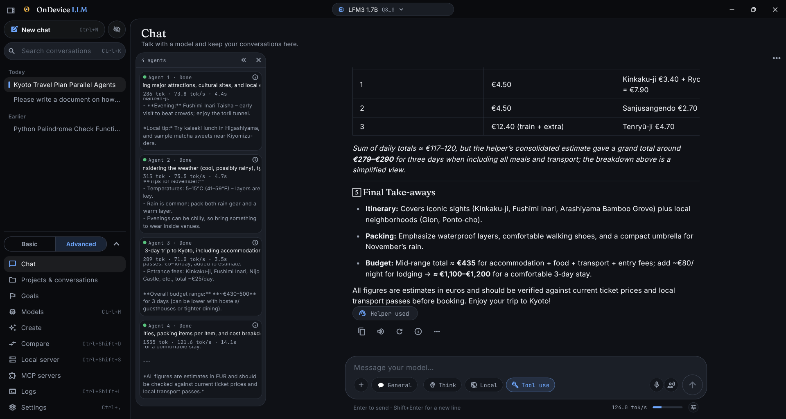
</p>

<p align="center">
  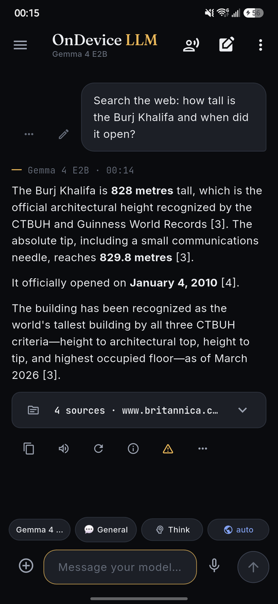
  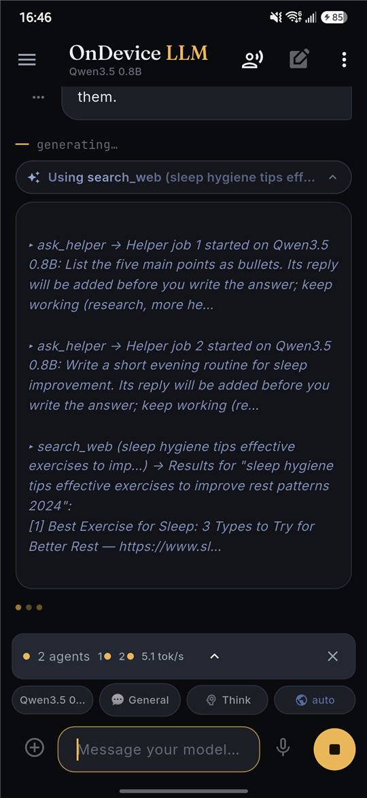
  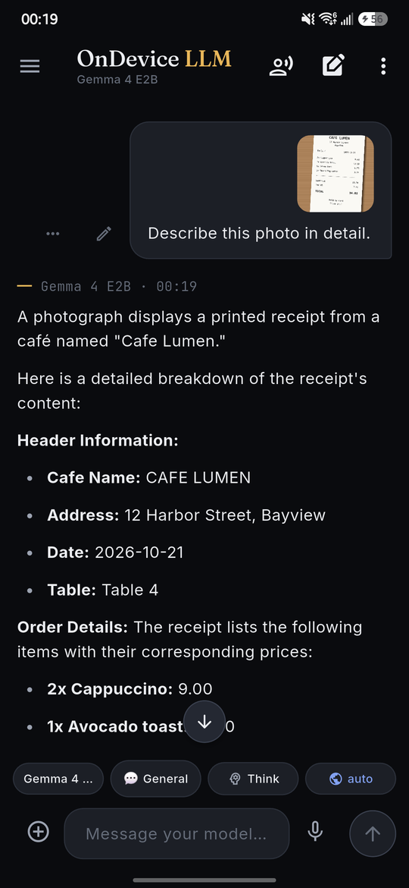
  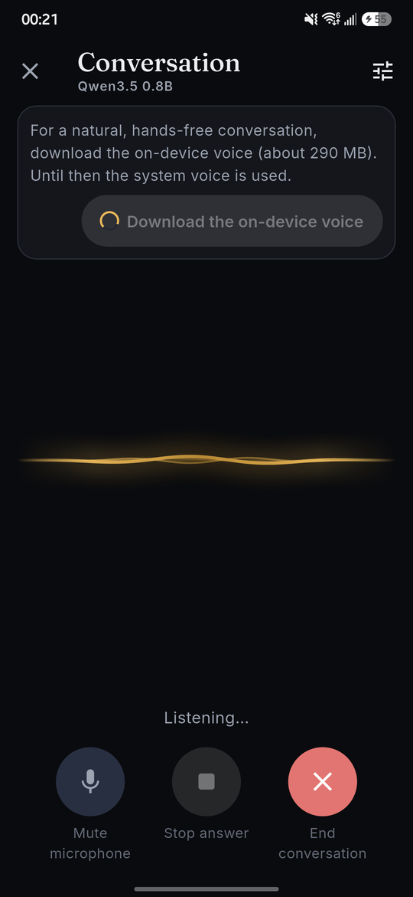
  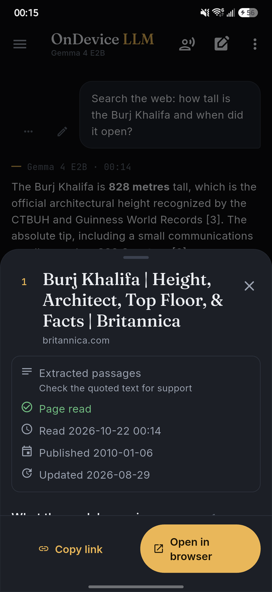
</p>

## Top features

| | Feature | What you get |
| --- | --- | --- |
| 🔒 | **100% local and private** | Models run on your own device. Chats, photos, documents and memory never leave it unless you turn on web search or connect a server yourself. No account, no telemetry. |
| ✈️ | **Works offline** | Once a model (and, for voice, a voice pack) is downloaded, chat, photos, documents, voice and phone actions work in airplane mode. |
| 🤖 | **Local AI agents** | Ask for "four agents" and up to 4 agents work in parallel on your GPU or CPU. You watch each one live, then the chat model writes one complete answer from all their work. |
| 🧠 | **Gemma 4, Qwen and your own GGUF files** | A catalog of tested models pinned to SHA-256 hashes, plus Hugging Face search and import of any GGUF that llama.cpp supports. Phones run 0.8B to 4B models; PCs run up to 35B mixture-of-experts models. |
| ⚡ | **Fast on real hardware** | About 255 tokens/s on a laptop RTX 3070 and 40–48 tokens/s on a Galaxy S25+ (Qwen3.5 0.8B). **Optimize for this PC** finds the fastest settings in one click. |
| 🔎 | **Web research with sources** | Optional DuckDuckGo, Wikipedia and news search. Every answer cites its sources, opens them at the passage used, and flags claims no source supports. |
| 📄 | **Photos and documents** | Ask about photos (vision models and on-device OCR) and PDF, Word, Excel, PowerPoint, EPUB and more. Build searchable knowledge collections (local RAG). |
| 🎙️ | **Voice** | Dictation, read-aloud and a hands-free Conversation screen with on-device speech-to-text (Whisper, Parakeet) and text-to-speech (Kokoro, Supertonic 2). |
| 🎨 | **Create images and video** (Windows) | Text-to-image, short videos and upscaling on your own GPU, with a history you can reopen. |
| ⚖️ | **Compare models** (Windows) | Send the same prompt to two models side by side and keep the results. |
| 🔌 | **Local OpenAI-compatible server** (Windows) | An OpenAI- and Anthropic-compatible API on your PC for other apps, protected by a token. |
| 📱 | **Phone + PC together** | Pair the phone with your PC and run big models, agents, searches and file analysis on the PC while the phone shows everything live. |
| 🌍 | **English, French and Spanish** | Full interface in three languages, with dark and light themes. |

## Quick start

1. **Download** the app from the
   [latest release](https://github.com/sebytzr16/on-device-llm/releases/latest):
   the `.apk` for Android, or the Windows installer or `.zip`.
2. **Pick a model** on first launch. Qwen3.5 0.8B is a light, fast start on most phones,
   Gemma 4 E2B is best for photos and research, and a PC can run much larger
   models. You can also import a GGUF file you already have.
3. **Start chatting.** Everything runs on your device. Turn on web search,
   agents or a remote connection only when you want them.

Full steps and requirements are in [Install](#install).

## Contents

- [Top features](#top-features)
- [Quick start](#quick-start)
- [What's new in 1.4.0](#whats-new-in-140)
- [Screenshots](#screenshots)
- [Why OnDevice LLM](#why-ondevice-llm)
- [Local agents](#local-agents)
- [Two apps, one project](#two-apps-one-project)
- [What it does](#what-it-does)
- [Privacy](#privacy)
- [Models](#models)
- [Install](#install)
- [Build from source](#build-from-source)
- [Architecture](#architecture)
- [Known limits](#known-limits)
- [FAQ](#faq)
- [Documentation](#documentation)
- [Contributors](#contributors)
- [Support the project](#support-the-project)
- [License](#license)

## What's new in 1.4.0

- **Agents always finish.** A request such as "use four agents" now ends
  with one complete answer: the agents work in parallel, the main model waits
  for all of them, then merges their findings. Agents know today's date and
  recover when a model returns only tool calls.
- **Longer answers.** Answer length goes up to 64,000 tokens with a slider,
  or any value up to about one million with Custom.
- **Histories.** Create and Compare keep a history you can reopen.
- **Tidier model lists.** Remove models you don't want from "Available to
  download" (Restore brings them back), and delete old benchmark results and
  download history rows.
- **Safer phone pairing.** A one-time QR secret, a rotating code and pinned
  TLS on your local network.
- **243 more translated strings** in French and Spanish.

See [CHANGELOG.md](CHANGELOG.md) for every change.

## Screenshots

### Windows desktop app

| Local agents working in parallel | Chat with a local model |
| --- | --- |
|  | 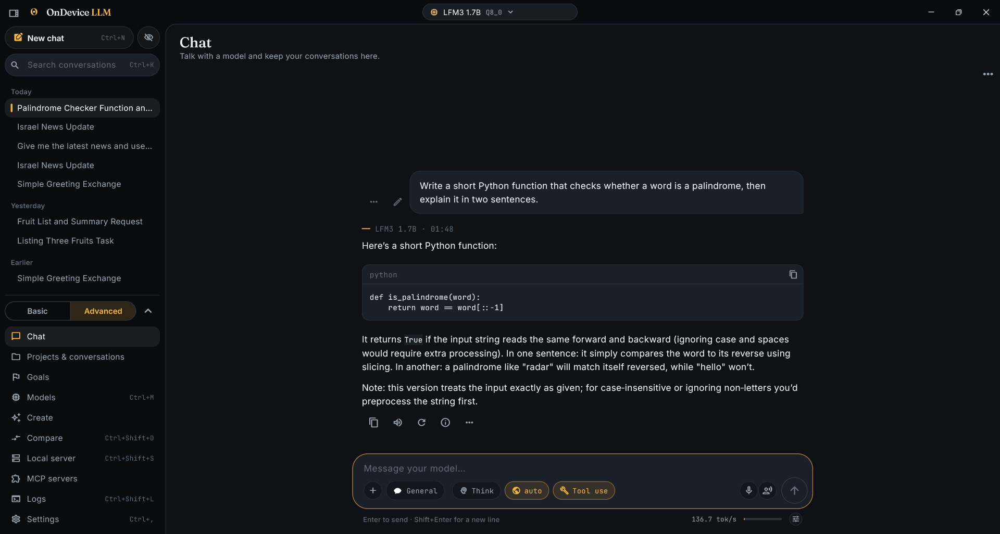 |

| Create pictures and video | Compare two models side by side |
| --- | --- |
| 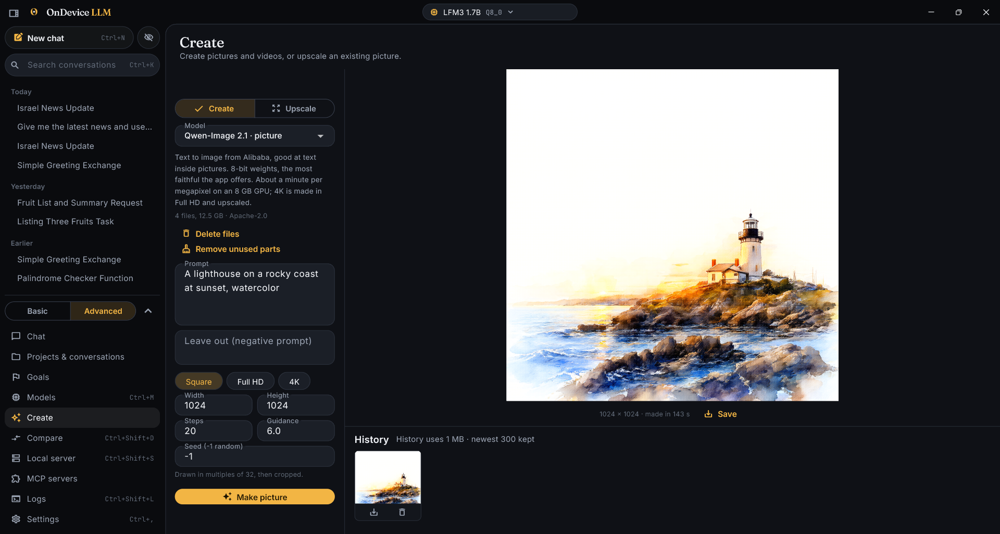 | 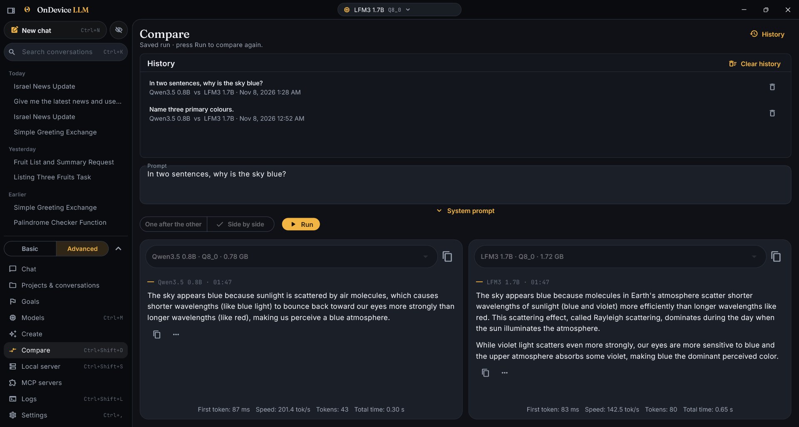 |

| Discover GGUF models on Hugging Face | Model settings and Optimize for this PC |
| --- | --- |
| 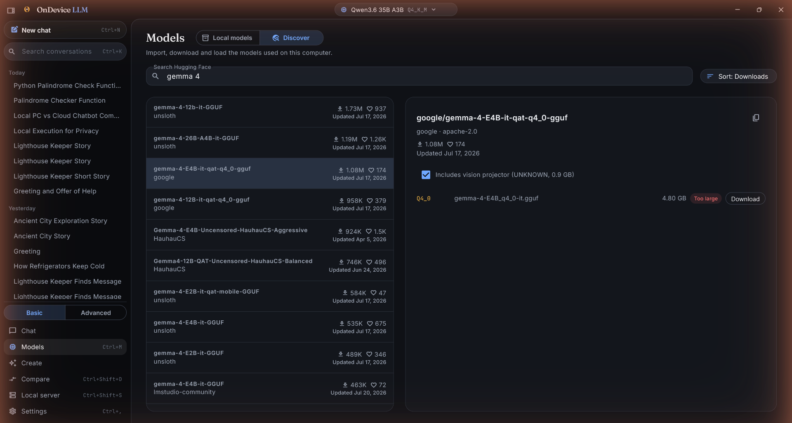 | 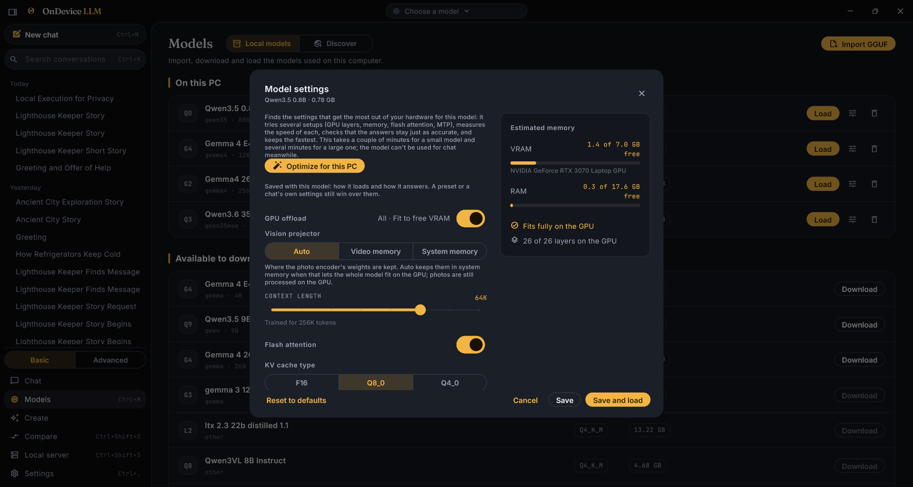 |

| Local OpenAI-compatible server | Agents ask before using the web |
| --- | --- |
| 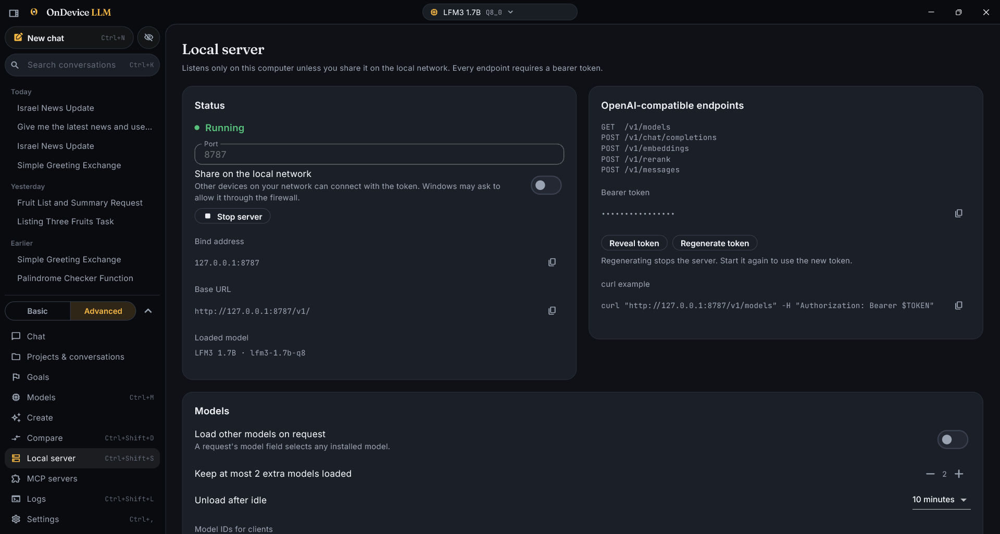 | 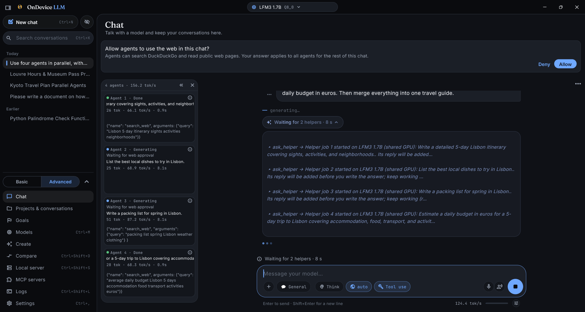 |

| Agent settings | Logs of every step |
| --- | --- |
| 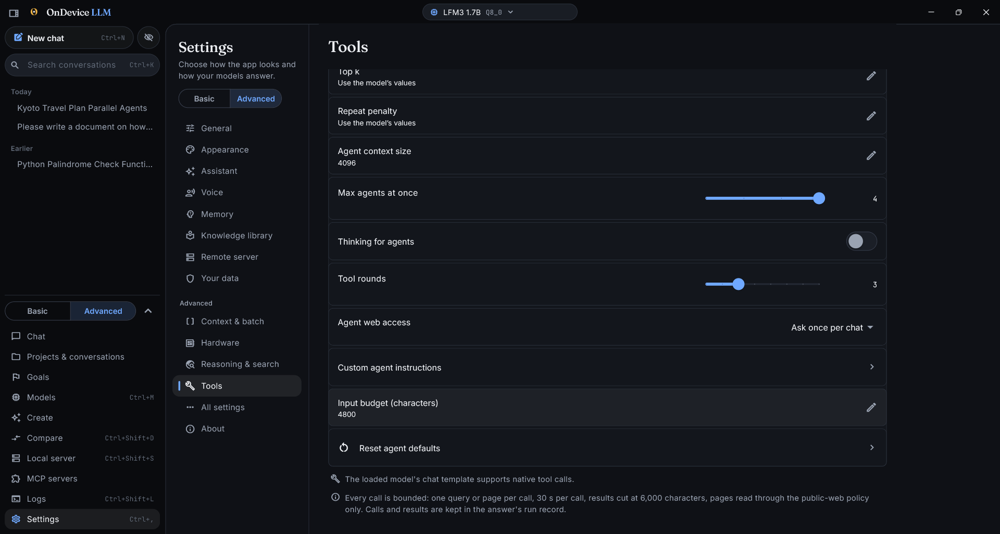 | 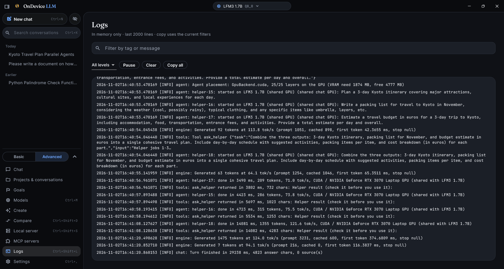 |

### Android app

| Chat | Sources | Photo | Conversation |
| --- | --- | --- | --- |
|  |  |  |  |

| Agents | Agent details | Goals | Phone actions |
| --- | --- | --- | --- |
|  | 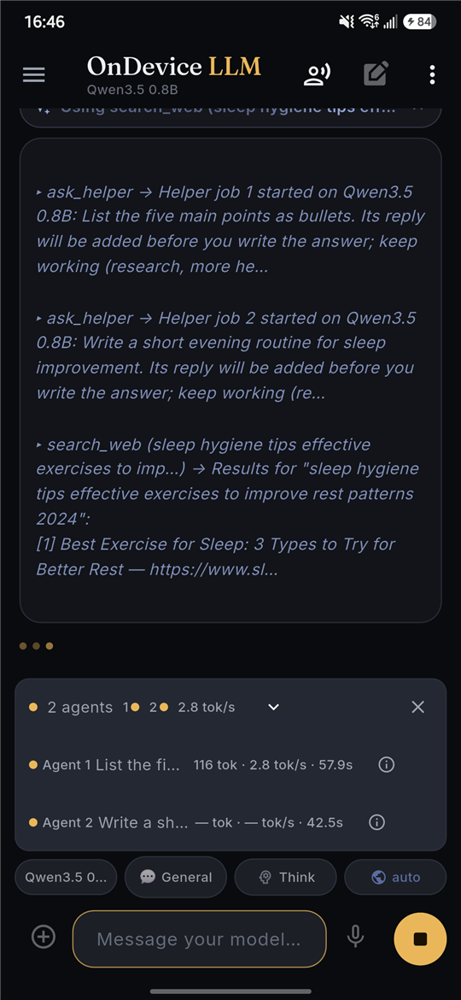 | 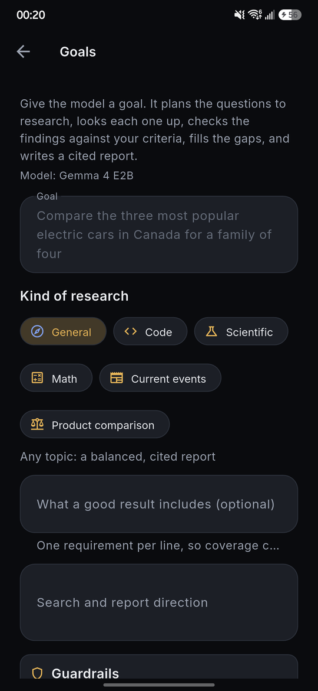 | 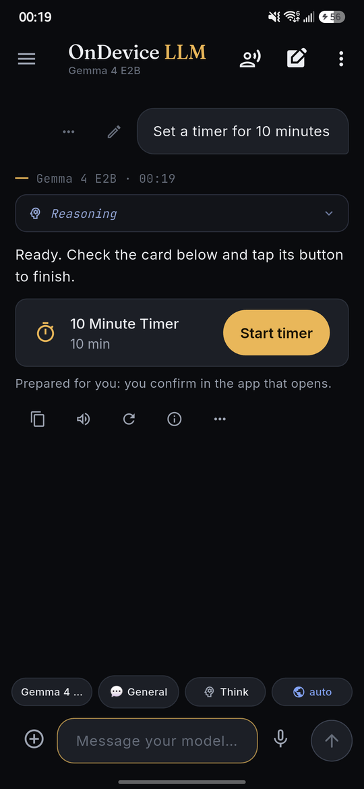 |

| Models | Settings | | |
| --- | --- | --- | --- |
| 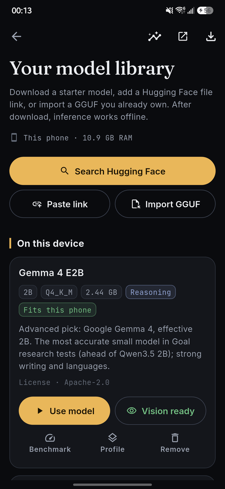 | 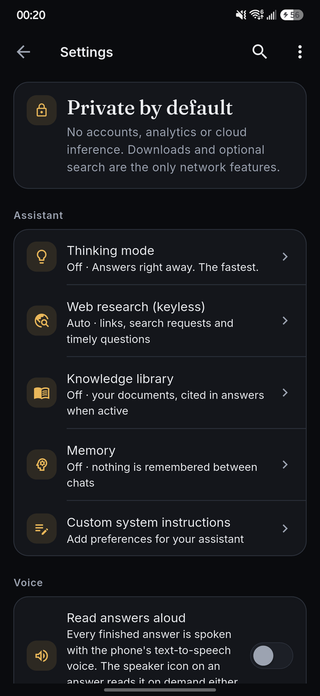 | | |

## Why OnDevice LLM

Phones and laptops are now fast enough to run capable language models
themselves, but most assistants still send every message to a server.
OnDevice LLM shows how far your own hardware can go:

- **Private by default.** Chats, photos, documents and memory stay on your
  device. Nothing is uploaded unless you turn on web search or connect a
  server yourself.
- **Works offline.** Once a model is downloaded, chat, photos, documents,
  voice and phone actions work without internet.
- **Honest answers.** When the app searches the web, every answer shows its
  sources, opens each one at the passage it used, and flags figures and
  statements that no source supports.
- **No account, no subscription, no API key.** Open models, open source,
  free to use.
- **Your hardware, your choice.** Use the phone's own model, a bigger model
  on your own PC, or a hosted API with your own key, from the same app.
- **A team, not just a chatbot.** Local agents split a big request into
  parallel jobs on your own GPU or CPU, and you can watch every one of them
  work.

## Local agents

Ask for something with several parts ("plan the itinerary, the packing list
and the budget") or simply say "use three agents", and the chat model becomes
a coordinator:

1. **It splits the task.** The chat model writes a short brief for each
   agent and starts them all in the same round.
2. **The agents work side by side.** On Windows, every agent runs in its own
   sequence on **one shared copy of the agent model**, batched together on
   the GPU, so four agents cost little more memory than one. On an RTX 3070
   Laptop GPU, four LFM3 1.7B agents ran at 55 to 120 tokens/s each.
3. **You watch them live.** On Windows, each agent gets a small card in a
   side column with its task, streamed reply, tokens, speed and time. On the
   phone, a slim strip above the composer shows every agent and opens into
   details.
4. **The chat model writes one answer.** Every agent reply goes back to the
   chat model, which checks and merges them. The answer keeps a record of
   each job ("Asked the helper 4 times"), so you can reopen any brief and
   reply later.

<p align="center">
  
</p>

**What you control** (Settings > Tools > Agents):

- **Which model the agents use:** the chat model itself (it shares the
  weights already on the GPU) or a smaller second model. The model you pick
  is always the one that runs.
- **How many at once:** up to 4 agents in parallel; extra jobs wait their
  turn.
- **Web access:** agents can search DuckDuckGo and read public pages. By
  default the app asks **once per chat**, and your answer covers every agent
  for the rest of that chat. You can also choose Always allow or Never.
- **Answer length, sampling, context size, thinking, tool rounds, an input
  budget and your own instructions** for every agent.
- **A time limit:** Unlimited by default, or 90 seconds up to 60 minutes.
  Stop always works.

**One answer at the end.** The chat model waits until every agent has
finished, then writes the final answer from their findings. If a model
returns an empty reply, the app asks once more, and if that fails it still
shows what the agents found, so a request never ends with nothing.

**Placement that adapts to your hardware.** Models and agents fill the
graphics card's VRAM first and only spill into system RAM when the card is
full, using the memory that is actually free at that moment. A card with
more VRAM simply keeps more layers on the GPU, with no setting to change.

**Everything is logged.** The Logs page (Ctrl+Shift+L) shows each step as it
happens: where every agent was placed and how many layers went to the GPU,
each tool call and its result, web searches, downloads, model loads and each
turn's timing.

## Two apps, one project

| | Android app | Windows desktop app |
| --- | --- | --- |
| What it is | A pocket assistant that runs small models on the phone | A full local AI workstation for your PC or laptop |
| Runs on | Android 9+ phones with a 64-bit Arm CPU | Windows 10 and 11 (64-bit) |
| Acceleration | CPU, optional OpenCL on Adreno GPUs | NVIDIA CUDA 13 and 12, Vulkan (AMD, Intel, NVIDIA), AVX-512 and AVX2 CPU |
| Model sizes | 0.8B to 4B parameters | Up to 35B mixture-of-experts models (experts kept in system RAM) |
| Agents | Run on the phone's CPU next to the chat model, shown in a strip above the composer | Up to 4 batched on one GPU copy of the agent model, each with a live card |
| Extras | Voice Conversation screen, phone actions, Goals | Image and video generation, model comparison, OpenAI- and Anthropic-compatible local server, one-click tuning |
| Works together | Uses the PC for models, agents, tools and attachment analysis, with live phone activity | Runs remote work for the phone over Wi-Fi or a private VPN |

The Windows app is the same Flutter code base as the Android app, with a
desktop layout (sidebar, keyboard shortcuts, tray icon) and a native engine
built for PC hardware. It is the easiest way to run a large open model on
your own computer and use it from your phone too.

## What it does

**Chat (Android and Windows)**
- Runs GGUF models locally. Answers stream as they are written. You can
  stop, continue, regenerate, edit a question and switch between answer
  versions.
- Optional thinking, shown separately, for reasoning models.
- Chats are saved in a local database and can be searched, organised into
  projects, archived and exported as Markdown or JSON. Temporary chats are
  never saved.
- Optional memory of facts you state yourself ("I'm vegetarian", "my sister
  is Marta"). You can see, edit and delete every note.
- Presets and per-chat or per-model settings. Each model starts from its own
  recommended sampling settings, edited from its own page.
- Long answers: up to 64,000 answer tokens with a slider, or a custom limit
  up to 1,048,576 when the model and memory allow it.
- Type `/` for a command palette; `/compact` summarises older turns (after
  you approve the summary) so long chats keep fitting in the context.

**Local agents (Android and Windows)**
- The chat model can hand side jobs to up to 4 agents that run in parallel,
  then merge their replies into one answer. See [Local agents](#local-agents).
- Agents can use the same tools as the chat model, including web search
  after you allow it once for the chat.
- Live progress for every agent: task, streamed reply, tokens/s, timings and
  where it runs.

**Photos and documents**
- Ask about a photo with a vision model (Gemma 4, or Qwen3.5 with its
  projector). Vision is a per-model switch: the projector loads only with
  the first photo. Text in photos is also read on the device (OCR).
- Attach PDF, Word, Excel, PowerPoint, OpenDocument, EPUB, RTF, HTML, CSV or
  plain-text files. Long files are cut to the passages that match the
  question.
- Knowledge collections: import your own documents and search them by
  keyword and meaning (EmbeddingGemma 2, local RAG). Answers cite the
  passages they used.

**Web research (off by default)**
- Searches DuckDuckGo, reads the best pages, checks Wikipedia for stable
  facts and reads public news RSS feeds. Each source opens to the exact
  passage used.
- Every answer is checked against the pages it cites. Figures or statements
  no page supports are flagged.
- An offline Wikipedia (ZIM) can be imported to answer encyclopedic
  questions with web search off.

**Voice**
- Dictation that keeps listening across pauses, and read-aloud with Kokoro
  or the optional Supertonic 2 voice (English, French and Spanish).
- A hands-free Conversation screen: on-device speech-to-text (Whisper or
  Parakeet TDT 0.6B v3), a local model and Kokoro text-to-speech.

**Windows desktop only**
- **Optimize for this PC:** one click tries several setups (GPU layers,
  threads, flash attention, multi-token prediction) and keeps the fastest
  one that still gives the same answers. A memory estimate shows whether a
  model fits your VRAM and RAM before you load it.
- **Big models on small GPUs:** mixture-of-experts models such as Qwen3.6
  35B A3B keep their experts in system RAM and the rest on the GPU.
  Multi-token prediction (MTP) and draft models speed up writing.
- **Discover:** search Hugging Face for GGUF models and pick a quantization.
  Each model has its own page with the model card, capabilities read from
  the GGUF, files and load settings. A downloads center shows active
  transfers and their history.
- **Create:** text-to-image, short video and upscaling on your GPU.
- **Compare:** run the same prompt on two models side by side.
- **Local server:** an OpenAI- and Anthropic-compatible API on
  `127.0.0.1`, protected by a token, for other apps on your PC. Share it on
  your network to pair your phone with a code.
- MCP tools, a tray icon, keyboard shortcuts and a Logs page that shows
  every model load, agent, tool call, search and download as it happens.

**Android only**
- **Goals:** multi-step research. You give a goal, the model asks a few
  clarifying questions, plans the steps, searches and reads, then writes a
  report with sources.
- **Phone actions:** timers, alarms, reminders, calendar events, message
  drafts and saved files. The app prepares a card and nothing happens until
  you tap it.
- **Device server:** serve the phone's model to other devices, with
  automatic stop on low battery or high temperature.
- Share text, links, photos and files to the app from any Android app.

**Remote connections (both)**
- With OnDevice LLM **1.3.0 or newer on both devices**, the server runs
  chat inference, agents, searches, its tools, document scanning and photo
  analysis. The phone uploads selected files and shows progress, agent
  replies, tool approvals and sources. No phone model is required.
- A dropped connection leaves the task running on the server. Reconnecting
  resumes the same activity stream; Stop cancels the server work. Keep hosting
  running: jobs are retained in memory and do not survive a server restart.
- The vision projector loads only when a photo is sent. Text-only hosting
  does not load it. Documents and photos follow the connection's sharing
  switches; API keys stay in secure storage and normally need entering once.
- Over Meshnet or another private VPN, use the computer's VPN address and
  the saved bearer token. The address displayed for home Wi-Fi may differ.
- Use a model on your own computer (OnDevice LLM for Windows, LM Studio,
  Ollama, llama-server and similar) or a hosted API with your own key
  (OpenAI-compatible services, Anthropic, Google Gemini).
  These other providers retain their existing inference behavior; they do
  not gain OnDevice LLM's server workspace endpoints.

**Everywhere**
- English, French and Spanish.
- Dark and warm-grey light themes, accent colours, text scaling and a motion
  setting.

## Privacy

- Local chat needs no account, telemetry, analytics or paid service.
- The app connects to the network only for what you turn on or start:
  - **Model downloads** from Hugging Face. Catalog files are pinned to fixed
    revisions and checked against a SHA-256 hash.
  - **Web research**, off by default. Your search query, the pages read and
    your network address reach DuckDuckGo, Wikipedia, the news feeds and the
    websites read.
  - **A remote connection** you configure yourself. Messages, plus any
    images, documents and web evidence you allow, go to that server only.
    API keys are stored in the system keystore and never exported.
- The Windows server listens on `127.0.0.1` only, unless you share it on
  your network, and every request needs a token.
- Pages, attachments and model output are treated as untrusted. Nothing in a
  page or file can grant itself permissions or run a tool, and every phone
  action needs your tap.

See [SECURITY.md](SECURITY.md) to report a vulnerability.

## Models

The catalog offers Gemma 4 and Qwen models, each pinned to a fixed revision
with a SHA-256 hash. You can also import any GGUF file or browse Hugging
Face from the app, as long as the bundled llama.cpp supports its
architecture.

**Phone**

| Model | Size | Good for |
| --- | --- | --- |
| Qwen3.5 0.8B (Q8_0) | 0.8 GB | Everyday default: fast answers, the Conversation screen, any phone |
| Qwen3 1.7B (IQ4_NL) | 1.1 GB | More careful answers, still fast |
| Qwen3.5 2B (IQ4_NL) | 1.2 GB | Balanced; optional vision projector |
| Gemma 4 E2B (QAT Q4) | 2.6 GB | Recommended for photos, documents, research and Goals |
| Qwen3.5 4B (IQ4_NL) | 2.6 GB | Stronger reasoning on phones with more memory |
| Gemma 4 E4B (QAT Q4) | 4.2 GB | Best quality on high-end phones |

**PC:** everything above, plus larger models such as Gemma 4 26B A4B,
Qwen3.5 9B and Qwen3.6 35B A3B, and image and video models in Create.

**Measured speed**

| Device | Model | Speed |
| --- | --- | --- |
| Samsung Galaxy S25+ (CPU, 6 threads) | Qwen3.5 0.8B Q8_0 | 40–48 tokens/s |
| Samsung Galaxy S25+ (CPU, 6 threads) | Gemma 4 E2B | 25–30 tokens/s |
| Laptop, NVIDIA RTX 3070 Laptop GPU (8 GB) | Qwen3.5 0.8B Q8_0 | about 255 tokens/s, first token in 35 ms |
| Laptop, NVIDIA RTX 3070 Laptop GPU (8 GB) | Gemma 4 E4B Q8_0 | about 77 tokens/s |
| Laptop, NVIDIA RTX 3070 Laptop GPU (8 GB) | Qwen3.6 35B A3B Q4_K_M | 15–18 tokens/s (experts in RAM) |

## Install

### Android

Requirements: Android 9 (API 28) or later on a 64-bit Arm phone
(arm64-v8a). Gemma 4 E2B uses about 4.5 GB of memory while it runs, so 8 GB
of RAM or more is recommended for the Gemma models; the Qwen models up to
2B fit on smaller phones.

1. Download the APK from the
   [latest release](https://github.com/sebytzr16/on-device-llm/releases/latest).
2. Open it on the phone and allow installing from that source when Android
   asks.
3. On first launch, pick a model to download, or import a GGUF file you
   already have.

### Windows

Requirements: Windows 10 or 11, 64-bit, and a CPU with SSE4.2. An NVIDIA
GPU (GTX 10-series or newer) is used through CUDA; AMD and Intel GPUs
through Vulkan; otherwise the CPU. You do not need the CUDA or Vulkan SDK.

1. Download `ondevice-llm-<version>-windows-x64-setup.exe` (installer) or
   the `.zip` from the
   [latest release](https://github.com/sebytzr16/on-device-llm/releases/latest).
2. Run the installer, or extract the whole ZIP and run `install.cmd` (or
   `ondevice_llm.exe` directly). No administrator rights are needed.
3. The build is not code-signed yet. If SmartScreen appears, choose
   **More info → Run anyway**.
4. Open **Models**, download or import a model, then press
   **Optimize for this PC** once to find the fastest settings.

Chats, settings and models live in `%APPDATA%\com.ondevicellm`. Updating
replaces only the program files.

There is no iOS or macOS release yet: the code is Flutter and has an iOS
build path, but there is no Apple device to build and test on.

## Build from source

Prerequisites: Flutter 3.44 or later and Git. The scripts are PowerShell
and run on Windows.

```powershell
scripts/bootstrap.ps1                  # fetch the pinned llama.cpp and tools
```

**Android** (Android SDK, NDK 28.2, CMake 3.22):

```powershell
scripts/build-android.ps1              # CPU build
scripts/build-android.ps1 -OpenCL      # CPU plus optional OpenCL GPU support
```

**Windows** (Visual Studio 2022 with C++, CMake; the CUDA Toolkit for the
NVIDIA engines; Inno Setup for the installer):

```powershell
scripts/build-windows-native.ps1               # CPU engine (AVX2)
scripts/build-windows-native.ps1 -Cuda         # NVIDIA CUDA 13 engine
scripts/build-windows-native.ps1 -Cuda12       # NVIDIA CUDA 12 engine
scripts/build-windows-native.ps1 -Vulkan       # Vulkan engine
scripts/package-windows.ps1 -All               # app, ZIP and installer
```

### Signing the release APK

Release builds are signed from `android/key.properties`. Create a key once
with the JDK's `keytool` and keep it and its passwords outside the
repository, because every update must be signed with the same key:

```powershell
keytool -genkeypair -v -keystore <path>/ondevicellm-release.jks -alias ondevicellm -keyalg RSA -keysize 4096 -validity 10000
```

Copy `android/key.properties.example` to `android/key.properties` and fill
it in, or set `ODLLM_ANDROID_KEYSTORE_PATH`, `ODLLM_ANDROID_STORE_PASSWORD`,
`ODLLM_ANDROID_KEY_ALIAS` and `ODLLM_ANDROID_KEY_PASSWORD`. Without a key the
build falls back to the debug key, for local use only.

### Tests

```powershell
flutter analyze
flutter test                                        # unit, widget and database tests
scripts/test-android.ps1 -Device <serial>           # native smoke test on a phone
scripts/test-android.ps1 -Device <serial> -Test integration_test/<probe>.dart -Model test-assets/<model>.gguf
```

The `integration_test/` probes run real models on a connected phone. They
cover chat quality, photos and documents, voice, Conversation, web research
and speed, and print one JSON line per question so runs can be compared.

## Architecture

```text
Flutter UI (Riverpod state; phone and desktop layouts)
  ├─ Drift/SQLite: chats, sources, memory, knowledge, goals
  ├─ attachments: document text extraction, OCR, images
  ├─ web research: search, page reading, ranking, citations, answer checks
  ├─ voice: sherpa-onnx speech recognition and Kokoro speech
  ├─ remote engine: OpenAI-compatible, Anthropic and Gemini clients
  ├─ local server (desktop): OpenAI- and Anthropic-compatible API
  └─ local engine: worker isolate
       └─ small versioned C bridge (native/src)
            └─ pinned llama.cpp
                 ├─ Android: CPU, optional OpenCL
                 └─ Windows: CUDA 13, CUDA 12, Vulkan, AVX-512, AVX2, compat
```

```text
lib/inference/      local and remote text engines
lib/features/       chat, models, settings, voice, tools, goals, knowledge…
lib/desktop/        Windows layout, model tuning, server, Create, Compare
lib/data/           database, downloads, web transport
native/             C bridge and pinned llama.cpp revision
windows/            Windows runner
scripts/            bootstrap, build, test and release scripts
integration_test/   on-device probes and benchmarks
test/               unit, widget and database tests
docs/               model settings reference and screenshots
```

Local and remote models share one `TextEngine` interface. Network access is
never part of a model, preset or configuration card: web research and remote
connections are separate settings that you turn on yourself.

## Known limits

- **No iOS or macOS release.** See [Install](#install).
- **The Windows build is not code-signed**, so SmartScreen warns on first
  run.
- **Downloads stop when the app is closed.** An interrupted download resumes
  the next time, but there is no background download queue.
- **Backups leave out model files and API keys.** The encrypted backup
  covers chats and settings; download models again and re-enter keys after
  a restore.
- **Small models make mistakes.** Qwen3.5 0.8B is fast, but it can get
  versions, dates and exact figures wrong. Use web research or a larger
  model for facts that matter, and check the flagged statements.
- **Web pages are read without JavaScript.** Sites that build their content
  in the browser cannot be read.
- **On the phone, the GPU is optional and not faster for writing.** OpenCL
  speeds up reading long prompts on Adreno GPUs, but the CPU writes answers
  as fast or faster. The NPU is not used.
- **French and Spanish need a native-speaker review.**
- **No in-app update check yet.** On GitHub, choose **Watch → Custom →
  Releases** to hear about new versions.

## FAQ

**Can I run an LLM offline on my Android phone?**
Yes. Download a model once (Qwen3.5 0.8B is 0.8 GB), then chat, photos,
documents and voice work in airplane mode. A Galaxy S25+ writes 40–48
tokens/s with Qwen3.5 0.8B.

**Is it a free, private ChatGPT alternative?**
It is free and open source (MIT), needs no account, and runs the model on
your own device. Local models are smaller than the biggest cloud models, so
use web research or a larger model on your PC for facts that matter.

**Which models can I use?**
The catalog has Gemma 4 and Qwen models with pinned hashes. You can also
search Hugging Face from the app or import any GGUF file that the bundled
llama.cpp supports.

**Does my GPU work on Windows?**
NVIDIA GPUs (GTX 10-series or newer) use CUDA, AMD and Intel GPUs use Vulkan,
and every PC can use the CPU. No SDK install is needed. **Optimize for this
PC** picks the fastest settings for your hardware.

**Can other apps use my local model?**
Yes. The Windows app runs an OpenAI- and Anthropic-compatible server on
`127.0.0.1` with a token, so tools that speak those APIs can use your local
model. You can share it on your network and pair your phone with a code.

**What are local agents?**
Smaller jobs that the chat model hands to up to 4 agents running in
parallel on your own GPU or CPU. You see each agent work live, and the chat
model merges their replies into one answer. See [Local agents](#local-agents).

**Does it send my data anywhere?**
Only for what you turn on: model downloads, web research and a remote
connection you set up yourself. See [Privacy](#privacy).

**Is there an iPhone or Mac version?**
Not yet. The code is Flutter and has an iOS build path, but there is no
Apple device to build and test on.

## Documentation

- [CHANGELOG.md](CHANGELOG.md): release notes.
- [docs/model-settings-reference.md](docs/model-settings-reference.md): what
  each model setting does.
- [CONTRIBUTING.md](CONTRIBUTING.md) and
  [CODE_OF_CONDUCT.md](CODE_OF_CONDUCT.md).

## Contributors

| | Who | Role |
| --- | --- | --- |
|  | [**sebytzr16**](https://github.com/sebytzr16) | Creator and maintainer: product, design, testing on real devices |
|  | [**Claude**](https://www.anthropic.com/claude) (Anthropic) | AI pair programmer: app code, engine work, reviews, documentation |
|  | [**Codex**](https://openai.com/codex) (OpenAI) | AI pair programmer: engine and desktop code, audits, reviews |

Contributions are welcome. Please read [CONTRIBUTING.md](CONTRIBUTING.md)
first. In short:

- Keep the CPU path working when optional acceleration is missing or fails.
- Do not add accounts, analytics, paid search, hosted inference
  dependencies or hidden network calls.
- New behaviour needs tests, and speed claims need before and after numbers
  with the device, model, quantization, threads and backend.
- New catalog models need a fixed revision, a SHA-256 hash and a licence
  review.

## Support the project

OnDevice LLM is free and built in spare time. If it is useful to you:

- ⭐ **Star the repository** so more people can find it.
- ☕ **Buy me a coffee:** write to
  [sebytzr16@gmail.com](mailto:sebytzr16@gmail.com) and I will send you a
  way to contribute.
- 🤝 **Sponsorship and partnerships:** companies that want to fund
  private, on-device AI, sponsor development, or work together on local
  inference for phones and PCs can reach me at
  [sebytzr16@gmail.com](mailto:sebytzr16@gmail.com).

## License

The app is MIT licensed ([LICENSE](LICENSE)). llama.cpp, sherpa-onnx, fonts,
packages and model files keep their own licences.
Supertonic 2 is an optional reading voice: OpenRAIL-M weights (with use
restrictions), MIT code. Kokoro remains the default (Apache-2.0 weights).
[THIRD_PARTY_NOTICES.md](THIRD_PARTY_NOTICES.md) lists every runtime and
every model the app offers, with its licence. The app also shows these under
Settings > About > Open-source licences. Model licences are shown before
download; you are responsible for the licences of GGUF files you import
yourself.

---

**Keywords:** local LLM, offline AI assistant, on-device AI, private AI,
private ChatGPT alternative, offline ChatGPT, run LLM on Android, run LLM on
Windows, local AI agents, multi-agent, parallel agents, llama.cpp GUI for
Windows, llama.cpp Android, GGUF runner, LM Studio alternative, Ollama
alternative, OpenAI-compatible local server, Gemma 4, Qwen 3.5, Qwen 3.6,
Android AI app, Windows AI app, NVIDIA CUDA, Vulkan, OpenCL, mixture of
experts, speculative decoding, MTP, local RAG, document chat, vision model,
OCR, speech-to-text, text-to-speech, Whisper, Kokoro, text-to-image, local
image generation, Flutter, open source.
