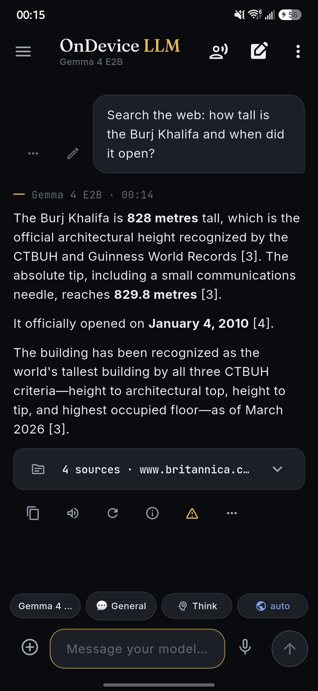
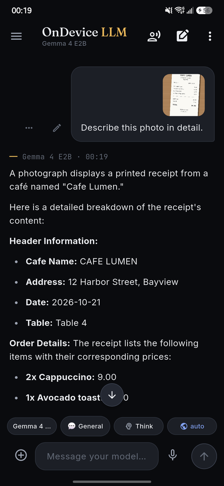
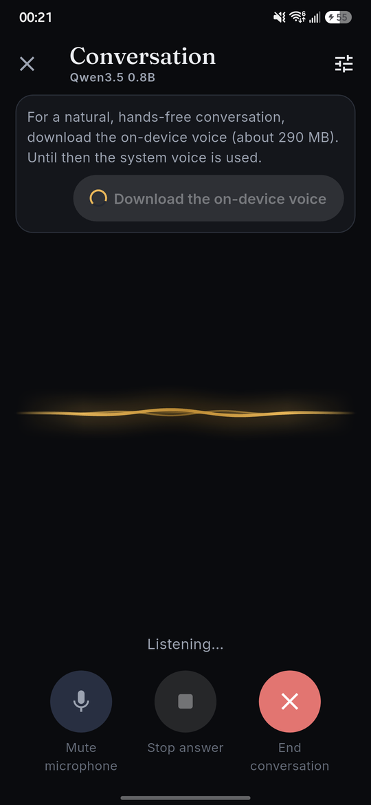
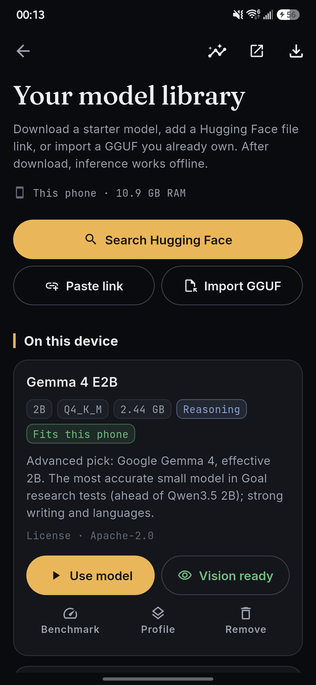
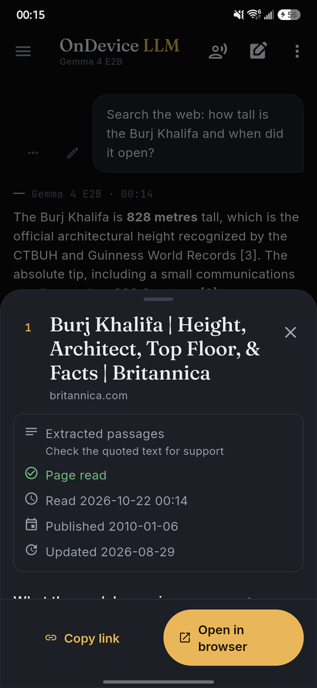
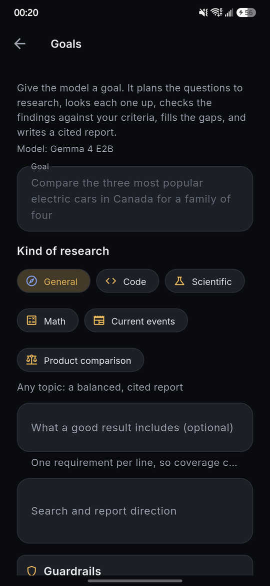
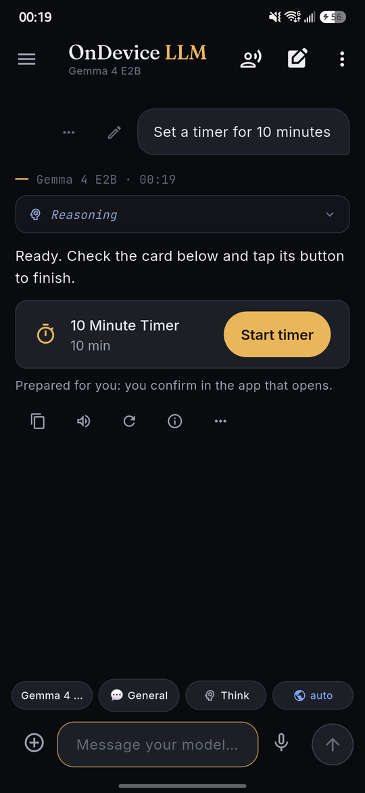
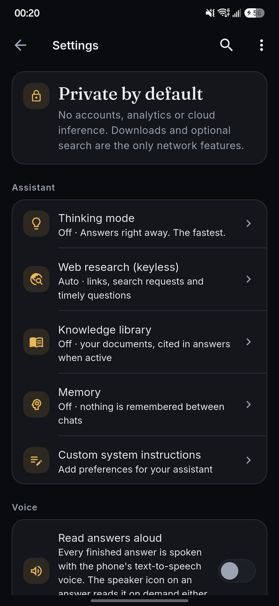

# OnDevice LLM

A private AI assistant that runs open language models on your Android
phone. Chat, ask about photos and documents, talk to it out loud, research a
question on the web with cited sources, and set timers and reminders by
asking. You can do all of it without an account, API key or server, and with
web search off nothing leaves the phone.

Version 1.0.0. Built with Flutter on a pinned
[llama.cpp](https://github.com/ggml-org/llama.cpp) runtime and tested on a
Samsung Galaxy S25+. See [CHANGELOG.md](CHANGELOG.md) for what is in this
release and [Known limits](#known-limits) for what is not.

<p align="center">
  
  
  
  
</p>

## What it was built for

Phones are now fast enough to run capable language models themselves, but
most assistants still send every message to a server. OnDevice LLM was built
to show how far a phone can go on its own:

- **Private by default.** Your chats, photos, documents and memory stay on
  the phone. Nothing is uploaded unless you turn on web search or connect a
  server yourself.
- **Works offline.** Once a model is downloaded, chat, photos, documents,
  voice and phone actions work in airplane mode.
- **Honest answers.** When the app searches the web, every answer shows its
  sources, opens each one at the passage it used, and flags figures and
  statements that no source supports.
- **No account, no subscription.** Open models, open source, free to use.
- **Your hardware, your choice.** Use the phone's own model, a bigger model
  on your own computer, or a hosted API with your own key, from the same app.

## Screenshots

| Chat | Sources | Photo | Conversation |
| --- | --- | --- | --- |
|  |  |  |  |

| Models | Goals | Phone actions | Settings |
| --- | --- | --- | --- |
|  |  |  |  |

## Platforms

The app and the APK are for Android only for now, because there is no iOS
device to build and test on. The code is Flutter and already has an iOS
build path, so an iOS release may follow in the future.

## What it does

**Chat on the phone**
- Runs GGUF models locally on the CPU, with optional OpenCL on Adreno GPUs.
  Answers stream as they are written. You can stop, continue, regenerate,
  edit a question and switch between answer versions.
- Optional thinking, shown in a separate pop-up, for models that support it.
- Chats are saved in a local database and can be searched, organised into
  projects, archived and exported as Markdown or JSON. Temporary chats are
  never saved.
- Optional memory of facts you state yourself ("I'm vegetarian", "my sister
  is Marta"). You can see, edit and delete every note.
- Presets, `/` prompt shortcuts and per-chat or per-model settings. An
  Effective settings page shows where each value comes from.

**Photos and documents**
- Ask about a photo with a vision model (Gemma 4, or Qwen3.5 with its
  projector). Text in photos is also read on the device (OCR), so models
  without vision can still read receipts and signs.
- Attach PDF, Word, Excel, PowerPoint, OpenDocument, EPUB, RTF, HTML, CSV or
  plain-text files. Long files are cut to the passages that match the
  question.
- Knowledge collections: import your own documents and search them by
  keyword and meaning (EmbeddingGemma 2). Answers cite the passages they
  used.

**Voice**
- Dictation and read-aloud.
- A hands-free Conversation screen: speech recognition (Whisper or Parakeet
  TDT 0.6B v3), a local model and Kokoro text-to-speech, all on the phone.

**Web research (off by default)**
- Searches DuckDuckGo, reads the best pages, checks Wikipedia for stable
  facts and reads public news RSS feeds for briefings. The answer cites its
  sources, and each source opens to the exact passage used.
- Every answer is checked against the pages it cites. Figures or statements
  no page supports are flagged on the answer.
- An offline Wikipedia (ZIM) can be imported to answer encyclopedic
  questions with web search off.

**Goals**
- Multi-step research: you give a goal, the model asks a few clarifying
  questions, plans the steps, searches and reads, then writes a report with
  sources. Some steps can use your files and phone actions.

**Phone actions**
- Timers, alarms, reminders, calendar events, message drafts and saved
  files. The app prepares a card and nothing happens until you tap it.

**Other devices**
- Remote connections: use a model on your own computer (LM Studio, Ollama,
  llama-server and similar, over your network) or a hosted API with your own
  key (OpenAI-compatible services, Anthropic, Google Gemini). The remote
  model can search, use tools and run the Conversation screen.
- Device server: the phone can serve its local model to other devices on
  your network through an OpenAI-compatible endpoint, with a live dashboard
  and automatic stop on low battery or high temperature.

**Everywhere**
- English, French and Spanish.
- Dark and light themes, six accent colours, text scaling and a motion
  setting (Full, Subtle, Off).
- Share text, links, photos and files to the app from any Android app.
- Daily scheduled prompts that run when you tap the notification.

## Privacy

- Local chat needs no account, telemetry, analytics or paid service. Android
  backups of app data are disabled.
- The app connects to the network only for what you turn on or start:
  - **Model downloads** from Hugging Face. Catalog files are pinned to fixed
    revisions and checked against a SHA-256 hash.
  - **Web research**, off by default. Your search query, the pages read and
    your network address reach DuckDuckGo, Wikipedia, the news feeds and the
    websites read.
  - **A remote connection** you configure yourself. Messages, plus any
    images, documents and web evidence you allow, go to that server only.
    API keys are stored in the Android keystore and never exported.
- Pages, attachments and model output are treated as untrusted. Nothing in a
  page or file can grant itself permissions or run a tool, and every phone
  action needs your tap.

See [SECURITY.md](SECURITY.md) to report a vulnerability.

## Models

The catalog offers Gemma 4 and Qwen models, each pinned to a fixed revision
with a SHA-256 hash.

| Model | Size | Good for |
| --- | --- | --- |
| Qwen3.5 0.8B (Q8_0) | 0.8 GB | Everyday default: fast answers, the Conversation screen, any phone |
| Qwen3 1.7B (IQ4_NL) | 1.1 GB | More careful answers, still fast |
| Qwen3.5 2B (IQ4_NL) | 1.2 GB | Balanced; optional vision projector |
| Gemma 4 E2B (QAT Q4) | 2.6 GB | Recommended for photos, documents, research and Goals |
| Qwen3.5 4B (IQ4_NL) | 2.6 GB | Stronger reasoning on phones with more memory |
| Gemma 4 E4B (QAT Q4) | 4.2 GB | Best quality on high-end phones |

You can also import any GGUF file or browse Hugging Face from the app. The
model must use an architecture and chat template that the bundled llama.cpp
supports. Unsupported files fail with a clear message.

Measured on the Galaxy S25+ (CPU, 6 threads): Qwen3.5 0.8B writes about
40–48 tokens per second, Gemma 4 E2B about 25–30. A photo question
with Gemma 4 E2B takes 4–14 seconds, and a question about an attached
document 2–5 seconds.

## Install

Requirements: an Android phone running Android 9 (API 28) or later, with a
64-bit Arm processor (arm64-v8a). Gemma 4 E2B uses about 4.5 GB of memory
while it runs, so 8 GB of RAM or more is recommended for the Gemma models;
the Qwen models up to 2B fit on smaller phones.

1. Download the APK from the project's Releases page.
2. Open it on the phone and allow installing from that source when Android
   asks.
3. On first launch, pick a model to download, or import a GGUF file you
   already have.

There is no iOS release yet (see [Platforms](#platforms)).

## Build from source

Prerequisites: Flutter 3.44 or later, the Android SDK, NDK 28.2, CMake 3.22
and Git. The scripts are PowerShell and run on Windows.

```powershell
scripts/bootstrap.ps1            # fetch the pinned llama.cpp and tools
scripts/build-android.ps1        # CPU build
scripts/build-android.ps1 -OpenCL  # CPU plus optional OpenCL GPU support
```

### Signing the release APK

Release builds are signed from `android/key.properties`. Create a key once
with the JDK's `keytool` and keep it and its passwords outside the
repository, because every update must be signed with the same key:

```powershell
keytool -genkeypair -v -keystore <path>/ondevicellm-release.jks -alias ondevicellm -keyalg RSA -keysize 4096 -validity 10000
```

Copy `android/key.properties.example` to `android/key.properties` and fill
it in, or set `ODLLM_ANDROID_KEYSTORE_PATH`, `ODLLM_ANDROID_STORE_PASSWORD`,
`ODLLM_ANDROID_KEY_ALIAS` and `ODLLM_ANDROID_KEY_PASSWORD`. Without a key the
build falls back to the debug key, for local use only, and
`scripts/build-android.ps1` says which certificate signed the APK.

Tests:

```powershell
flutter analyze
flutter test                                        # unit, widget and database tests
scripts/test-android.ps1 -Device <serial>           # native smoke test on a phone
scripts/test-android.ps1 -Device <serial> -Test integration_test/<probe>.dart -Model test-assets/<model>.gguf
```

The `integration_test/` probes run real models on a connected phone. They
cover chat quality, photos and documents, voice, Conversation, web research
and speed, and they print one JSON line per question so runs can be
compared.

## Architecture

```text
Flutter UI (Riverpod state)
  ├─ Drift/SQLite: chats, sources, memory, knowledge, goals
  ├─ attachments: document text extraction, OCR, images
  ├─ web research: search, page reading, ranking, citations, answer checks
  ├─ voice: sherpa-onnx speech recognition and Kokoro speech
  ├─ remote engine: OpenAI-compatible, Anthropic and Gemini clients
  └─ local engine: worker isolate
       └─ small versioned C bridge (native/src)
            └─ pinned llama.cpp (CPU, optional OpenCL)
```

```text
lib/inference/      local and remote text engines
lib/features/       chat, models, settings, voice, tools, goals, knowledge…
lib/data/           database, downloads, web transport
native/             C bridge and pinned llama.cpp revision
scripts/            bootstrap, build, test and release scripts
integration_test/   on-device probes and benchmarks
test/               unit, widget and database tests
docs/               model settings reference and screenshots
```

Local and remote models share one `TextEngine` interface. Network access is
never part of a model, preset or configuration card: web research and remote
connections are separate settings that you turn on yourself.

## Known limits

- **Android only.** The iOS build path exists, but it has not been built or
  tested, because there is no iPhone or Mac to test on. See
  [Platforms](#platforms).
- **Downloads stop when the app is closed.** An interrupted download resumes
  where it stopped the next time the app downloads, but there is no
  background download queue.
- **No encrypted backup.** Chats can be exported to Markdown or JSON, but
  there is no encrypted backup and restore of the whole app.
- **LoRA adapters are untested on a phone.** Import and attach work in the
  app, but no adapter has been run on real hardware.
- **Google Gemini is untested live.** The Gemini client is unit-tested
  against recorded responses only. LM Studio has been tested end to end.
- **GPU is optional, not faster for decoding.** OpenCL speeds up reading
  long prompts on Adreno GPUs, but the CPU writes answers as fast or
  faster, so Auto always picks the CPU. Vulkan is experimental and the NPU
  is not used.
- **Small models make mistakes.** Qwen3.5 0.8B is fast, but it can get
  versions, dates and exact figures wrong. Use web research or a larger
  model for facts that matter, and check the flagged statements.
- **Web pages are read without JavaScript.** Sites that build their content
  in the browser cannot be read.
- **French and Spanish need a native-speaker review**, and some diagnostic
  text is still English.
- **Speculative decoding is experimental.** It is off by default because it
  was slower on the tested phone.

## Documentation

- [CHANGELOG.md](CHANGELOG.md): release notes.
- [docs/model-settings-reference.md](docs/model-settings-reference.md): what
  each model setting does.
- [CONTRIBUTING.md](CONTRIBUTING.md) and
  [CODE_OF_CONDUCT.md](CODE_OF_CONDUCT.md).

## Contributing

- Keep the CPU path working when optional acceleration is missing or fails.
- Do not add accounts, analytics, paid search, hosted inference
  dependencies or hidden network calls.
- New behaviour needs tests, and speed claims need before and after numbers
  with the device, model, quantization, threads and backend.
- New catalog models need a fixed revision, a SHA-256 hash and a licence
  review.
- Do not ship a switch that does nothing: disable unsupported options or
  explain why they are unavailable.

## License

The app is MIT licensed ([LICENSE](LICENSE)). llama.cpp, sherpa-onnx, fonts,
packages and model files keep their own licences.
[THIRD_PARTY_NOTICES.md](THIRD_PARTY_NOTICES.md) lists every runtime and
every model the app offers, with its licence. The app also shows these under
Settings > About > Open-source licences. Model licences are shown before
download; you are responsible for the licences of GGUF files you import
yourself.
